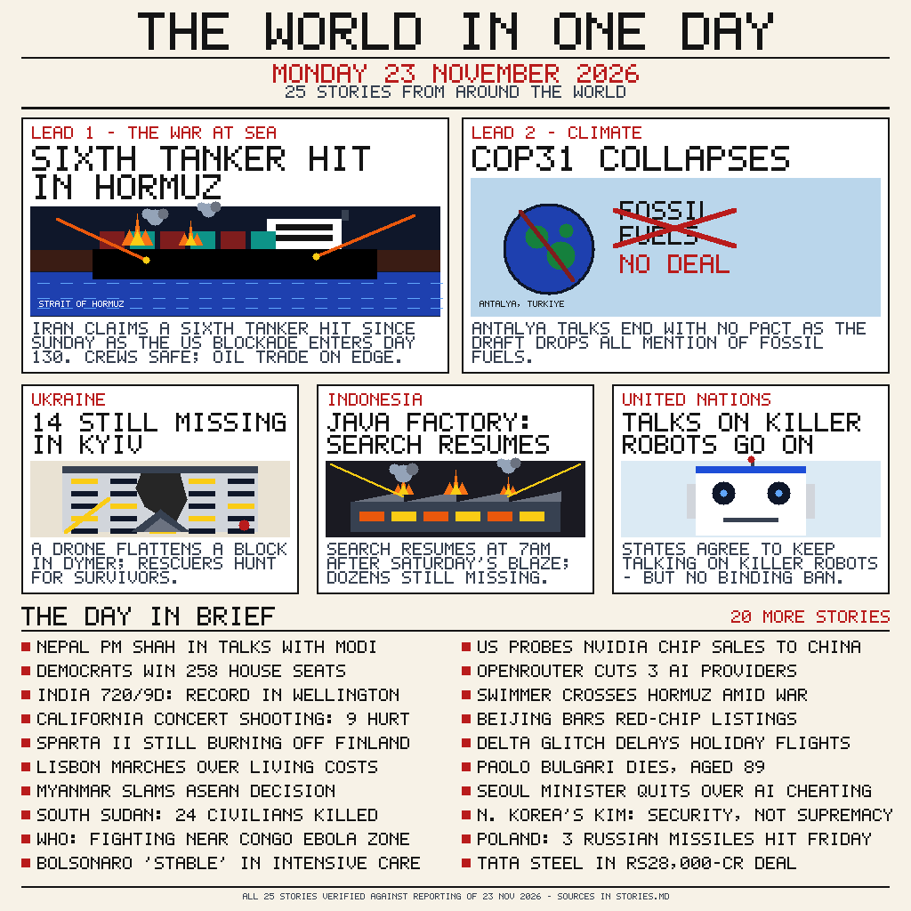

# The World in One Day — Monday 23 November 2026

[](https://make.fun/bounty/news-image-20261123?utm_source=github&utm_medium=readme&utm_campaign=news-image-20261123)
[](https://make.fun/bounty/news-image-20261123/leaderboard?utm_source=github&utm_medium=readme&utm_campaign=news-image-20261123)
[](https://make.fun/bounty/news-image-20261123?utm_source=github&utm_medium=readme&utm_campaign=news-image-20261123)

One image summing up the world's news of **Monday 23 November 2026** — a
front page with the day's biggest stories and a 20-item world brief:
25 verified stories in total, from a sixth tanker hit in the Strait of
Hormuz to COP31 collapsing in Antalya with no fossil-fuel deal.
Rendered by pure-stdlib Python — no third-party packages, no network,
no randomness; the output is deterministic.



Built for [make.fun](https://make.fun) — join via my referral link:
https://make.fun/r/00qq05wa

## How it is made

`main.py` (Python 3.13, standard library only) draws the image from scratch
with its own tiny PNG writer and 5x7 bitmap font. Running it twice produces
byte-identical files.

```sh
mkdir -p out && MAKEFUN_OUTPUT_DIR=out python3 main.py   # writes out/entry.png (1024x1024)
```

## Stories

Every story in the image is listed with its source in [STORIES.md](STORIES.md).
All facts were verified against live reporting on 23 November 2026; items
first reported on Saturday 21 or Sunday 22 November are marked as such and
are included only where they were still the live news of Monday morning
(ongoing rescue, search resuming, fallout and reactions).

## License

MIT — see [LICENSE](LICENSE).
